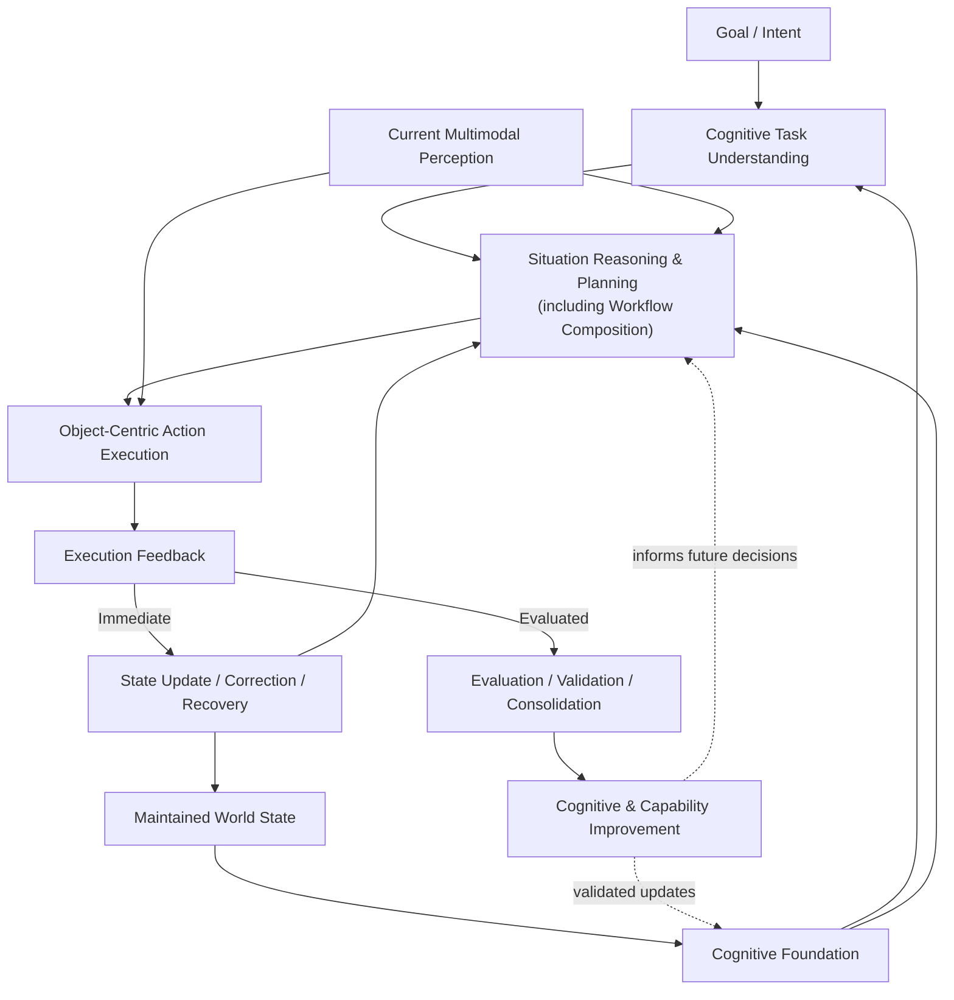

# ULA-RIS — Conceptual Architecture v0.1

**Open ULA | Cognition-Grounded Physical Intelligence**

**Status:** Public research proposal · Conceptual and testable · Not yet validated

> **Architecture describes how to test the hypotheses, not how to prove them.**

This document specifies the proposed **functional responsibilities, interfaces, state and information flows, and ablation boundaries** of the ULA Robot Intelligence System (**ULA-RIS**). It does not prescribe a unique model, data structure, training method, software stack, or robot body. Definitions follow [GLOSSARY.md](GLOSSARY.md); causal claims and evidence standards are in [HYPOTHESIS.md](HYPOTHESIS.md).

## 1. Design intent and boundaries

ULA-RIS investigates whether a maintained, action-relevant **Cognitive Foundation**, jointly used with **Current Multimodal Perception**, can improve **Task Success, Generalization, and Deployment Efficiency** under comparable conditions.

The architecture is a *testable intervention*, not evidence that the proposed root cause is correct. A comparable system may realize memory, reasoning, or world state implicitly; the architecture does not assume that perception-to-action systems lack these capabilities.

**Functional design requirements**

1. Maintain task-relevant understanding across time without treating history as infallible.
2. Ground decisions jointly in maintained cognition and current observations, including uncertainty and contradictions.
3. Compose task workflows and semantic actions according to goals, context, and available capabilities.
4. Ground physical manipulation in the **object being operated on**, while respecting embodiment, surrounding space, and physical constraints.
5. Separate **immediate state update, correction, and recovery** from **validated experience consolidation**.
6. Expose interfaces and component boundaries that allow controlled comparison and ablation.

These requirements are research targets, not assertions of achieved performance.

## 2. Functional architecture

**How to read this diagram:** It depicts dependencies and feedback, **not a rigid sequential pipeline**. Goal/intent can emerge from multimodal interaction and context. Perception can update cognition before, during, and after action. Workflow Composition is a responsibility **within** reasoning and planning, not a compulsory stage after planning. Immediate correction and longer-term learning have different evidence and validation requirements. The `S → W → C` path updates relevant maintained **world state**, not validated **Knowledge & Experience**. A candidate reusable lesson must pass through `L → I → C` before consolidation.

### 2.1 Cognitive Foundation

The Cognitive Foundation is the **maintained, action-relevant subset of cognition** used to support task understanding and decisions. It encompasses three complementary awareness responsibilities and one cross-cutting resource:

| Responsibility | Maintains | Does not imply |
|---|---|---|
| **World Awareness** | Physical entities, object states and properties, spatial relationships, relevant changes and uncertainty across time | An exhaustive geometric reconstruction or a static map alone |
| **Situation Awareness** | Active events, activities, interactions, task context, and their temporal relevance | A separate physical world disconnected from World Awareness |
| **Self Awareness** | Robot capabilities, embodiment, limitations, and operating constraints | Raw proprioception alone or an assumption of unlimited capabilities |
| **Knowledge & Experience** | Reusable knowledge and appropriately validated lessons supporting the awareness domains | An independent fourth world-state database or automatic retention of every interaction |

These are **functional responsibilities**, not four required models, stores, or services. Cognition is broader than the Cognitive Foundation; reasoning and planning **use** the foundation but are not synonymous with it.

### 2.2 Current Multimodal Perception

Perception supplies current and recent observations, relevant estimates, timestamps, and uncertainty. It helps detect changes, resolve ambiguity, and challenge stale cognitive state. A missing observation, including one caused by occlusion, is **not automatically evidence of absence**. Conversely, maintained cognition must not override clear, trustworthy current evidence.

### 2.3 Cognitive Task Understanding

Task understanding interprets goals and instructions against context, available knowledge, and relevant constraints. It identifies intended outcomes, information needs, and ambiguity requiring clarification. It is **not** a claim that perception begins only after the goal is understood.

### 2.4 Situation Reasoning & Planning

This responsibility combines goals, maintained cognition, current perception, and robot capabilities to assess the situation, feasibility, likely consequences, and constraints; to select or compose a workflow; and to determine intended state transitions and success checks.

**Workflow Composition** organizes task steps and **semantic actions** (for example, grasp, hold, release, push, pull, press, lift, rotate) according to current conditions. It does not require a predefined physical trajectory for every task variation. This responsibility does **not** replace motion control, contact control, or physical execution.

### 2.5 Object-Centric Action Execution

**Manipulation Intelligence** grounds an intended semantic action in the **target object's actionable state**, including its pose/state, affordances, relevant physical and material properties, relative geometry, contact/force constraints, and observed outcomes. Robot embodiment, safety constraints, and surrounding space are essential constraints, **not competing centers** of manipulation reasoning.

The executor interacts with available control and actuation systems; ULA-RIS does not assume a particular controller, end effector, or body morphology. Execution may require continuous sensing, low-level control, local correction, and escalation when constraints cannot be satisfied.

## 3. Four core technologies and ownership

| Technology | Primary functional responsibility | Boundary |
|---|---|---|
| **APWM — AI Physical World Model** | Persistent physical-world understanding supporting World Awareness | Not task planning, navigation, or manipulation by itself |
| **Experience Intelligence** | Evaluation, validation, and consolidation of reusable interaction experience | Not raw logging or unrestricted online self-training |
| **Workflow Composition** | Goal- and situation-conditioned composition of task steps and semantic actions | Part of reasoning and planning; not a fixed trajectory library |
| **Manipulation Intelligence** | Object-centric grounding and adaptation of physical interaction | Not merely grasp selection or trajectory replay |

**APWM — canonical definition**

> Represents and maintains a persistent understanding of the physical world, including objects, their states, spatial relationships between objects, and changes over time, to support situation reasoning, planning, and action.

Here *spatial relationships between objects* means **physical spatial relationships**, not interpersonal or social relationships. People may be represented as physical entities for spatial reasoning; their activities and interactions are addressed through Situation Awareness. APWM does not require exhaustive 3D reconstruction or continuous tracking of every object.

## 4. Foundational interfaces and information contracts

The following are **conceptual interface contracts**, not a mandated API, storage schema, or implementation recipe.

| Interface | Information that must be available | Required behavior / boundary |
|---|---|---|
| **Perception ↔ Cognitive Foundation** | Observations, relevant prior state, temporal reference, uncertainty, detected changes and contradictions | Update relevant state without treating occlusion as disappearance; preserve unresolved uncertainty |
| **Goal / Context → Task Understanding** | Goal, context, relevant cognitive knowledge, constraints and ambiguity | Produce task intent, desired outcome and information needs; request clarification when necessary |
| **Foundation + Perception → Reasoning & Planning** | Maintained state, current evidence, confidence, capability constraints and goal | Support relevance retrieval, temporal alignment, conflict detection, uncertainty handling, and grounded composition; assess feasibility and alternatives |
| **Planning → Action Execution** | Intended object/state transition, semantic action, constraints and success conditions | Ground in current object and embodiment; allow local adaptation rather than presuming a fixed trajectory |
| **Execution → Immediate Feedback** | Observed effects, task progress, constraint violations, failures and uncertainty | Support correction, recovery and timely state updates during the task |
| **Feedback → Experience Validation** | Candidate lesson, relevant context, outcome evidence and applicability limits | Evaluate safety, correctness and reuse before long-term consolidation |
| **Validated Improvement → Future Decisions** | Approved cognitive or capability changes and their scope | Apply controlled updates; retain ability to assess regressions and rollback where relevant |

### 4.1 State and uncertainty

A maintained state may be incomplete, stale, or wrong. Decisions should account for **recency, provenance, confidence, and task relevance** where available. Current perception and maintained state can disagree; the system must have a way to detect and handle contradictions rather than silently preferring one source in all cases.

A persistent world state is **not** a demand to reconstruct every object continuously. It is a proposal to retain and update the information that materially changes subsequent decisions.

### 4.2 Two distinct feedback paths

**Immediate path — within-task:** new observations and action feedback may update current state, trigger correction, request clarification, or initiate recovery. Such updates can occur without creating a reusable lesson.

**Evaluated path — across tasks:** candidate lessons and capability changes are assessed for correctness, safety, transferability, and regression risk before broader reuse. **State update is not experience consolidation.** A single success or failure does not automatically justify a lasting behavioral change.

## 5. Functional ablation boundaries

These are **candidate comparisons**, not a requirement to run every baseline in every experiment, nor claims that every responsibility can be isolated perfectly. Each comparison must document the information, capacity, computation, and capabilities retained in the baseline. A strong perception-to-action baseline may already include memory, history, or implicit state.

| Ablation / comparison | What changes | What it can test | Important confounders |
|---|---|---|---|
| **Persistent-state availability** | Compare persistent state against (a) no persistent state with an equal-length history window, or (b) an equal-information baseline with different state organization; specify which comparison is used | Contribution of persistence under delay, occlusion, and environmental change | Context length, extra observations, retrieval compute |
| **Joint cognition–perception grounding** | Compare combined grounding with matched alternatives using current observations or maintained state differently | Value of reconciling historical and current evidence | Input information parity, observation quality, fusion capacity |
| **Workflow Composition** | Compare goal-conditioned composition with candidate baselines: (a) fixed workflow library, (b) learned end-to-end planner with matched capacity, or (c) strong LLM-based planner with matched information and compute; report which is used | Transfer to unseen task combinations | Planner capacity, available actions, task difficulty |
| **Validated experience reuse** | Compare validated reusable experience with no reuse or controlled alternatives | Recurrence of failures, adaptation and cross-task transfer | Additional training, memory size, evaluation cost, leakage |
| **Object-centric grounding** | Compare object-state/constraint grounding with credible alternative action grounding | Manipulation adaptation to unseen objects, poses and conditions | Perception accuracy, control quality, embodiment |
| **Integrated ULA-RIS** | Compare the integrated intervention with strong, resource-accounted baselines | Net Task Success, Generalization and Deployment Efficiency | Interactions among components, engineering and runtime overhead |

A positive component ablation supports the **tested intervention mechanism** under the specified conditions; it does not, by itself, establish the broader **Root-cause Hypothesis**. Negative results must also be interpreted within the tested implementation and resource budget. See [HYPOTHESIS.md](HYPOTHESIS.md) and [EXPERIMENTS.md](EXPERIMENTS.md).

## 6. System evaluation and operational boundaries

ULA-RIS is evaluated against the three frozen top-level outcomes:

1. **Task Success:** intended task completion, first-attempt success, recovery, and required human intervention.
2. **Generalization:** transfer to held-out objects, states, environments, task compositions, and temporal changes.
3. **Deployment Efficiency:** data, adaptation, training, engineering, computation, and human-support resources required to reach and sustain a specified level of task performance.

**Compare efficiency at comparable Task Success levels.** Report performance–cost trade-offs, added inference latency, memory/storage, integration burden, and failure modes. Improvement in one submetric is not sufficient if it causes unacceptable regressions elsewhere.

Real-world outcomes depend on both **intelligence and embodiment**. Experiments should hold hardware and action capabilities comparable where feasible and distinguish perception, cognition, planning, control, and hardware-related failures. Safety constraints and the cost of human intervention are part of system evaluation, not assumed away by the architecture.

## 7. Public scope, open questions, and research status

**In scope for public v0.1:** functional responsibilities, conceptual interfaces, information and feedback flows, evaluation boundaries, and proposed ablations.

**Not specified:** proprietary state schemas, update algorithms, training recipes, model weights, datasets, production deployment details, hardware designs, or product commitments. The architecture is **not** a claim of a validated working system.

Open questions include whether explicit persistent state provides benefits beyond strong implicit-state baselines; which responsibilities matter under which conditions; how to balance freshness and persistence; how to validate reusable experience; and whether net benefits exceed added computational and engineering costs. See [OPEN_QUESTIONS.md](OPEN_QUESTIONS.md).

**Research status:** v0.1 is a conceptual architecture for investigation. It may be revised, simplified, or rejected based on diagnostic evidence and controlled experiments.

---

**Related documents:** [README](README.md) · [GLOSSARY](GLOSSARY.md) · [HYPOTHESIS](HYPOTHESIS.md) · [OPEN QUESTIONS](OPEN_QUESTIONS.md) · [EXPERIMENTS](EXPERIMENTS.md)
