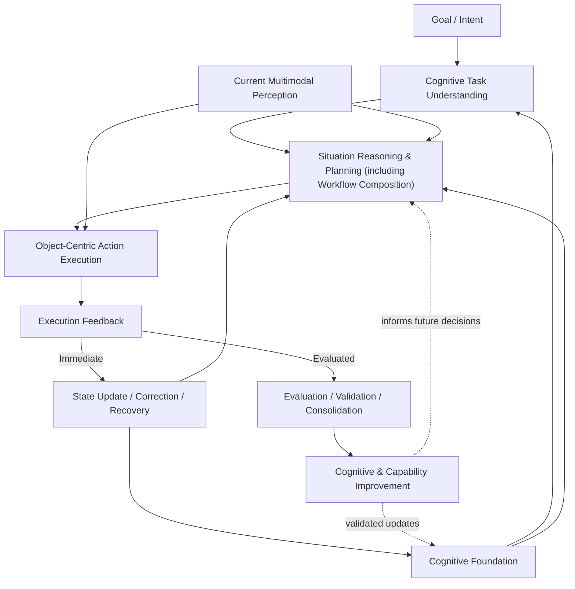

# Open ULA

### Cognition-Grounded Physical Intelligence

*A public research initiative by Synwyn ULA*

**ULA Robot Intelligence System (ULA-RIS)**

> **The central research question**  
> Can an explicit, persistent **Cognitive Foundation**—combined with current multimodal perception—improve **Task Success, Generalization, and Deployment Efficiency** in physical-world robotics?

*Beyond learning how to act, can robots make better decisions by combining what they know, what they perceive, and what they aim to achieve?*

**Research status:** v0.1 · Hypotheses and conceptual architecture · **Not a validated system or performance claim**

---

## The Problem

### Capable actions. Limited generalization. High deployment cost.

Robots can perform increasingly sophisticated actions, yet turning these capabilities into consistently successful, everyday task completion remains difficult.

A major paradigm in contemporary robot learning is **perception-to-action**. Large-scale data and training have made this approach increasingly capable. However, the open physical world is combinatorially complex: new objects, changing environments, novel task compositions, and unexpected events create far more situations than can be economically covered by data collection, training, or engineering alone.

Three challenges remain:

- **Task Success:** Robots struggle to consistently complete useful tasks in unfamiliar or changing conditions.
- **Generalization:** Capabilities learned in one setting do not always transfer to new objects, tasks, or environments.
- **Deployment Efficiency:** Achieving acceptable performance often requires extensive data collection, retraining, engineering adaptation, and human intervention.

## Our Hypotheses

### Root-cause Hypothesis

A significant part of these challenges may stem from the lack of a sufficiently persistent, compositional, and action-grounded **Cognitive Foundation**—encompassing **World Awareness, Situation Awareness, Self Awareness**, and reusable **Knowledge & Experience**.

### Intervention Hypothesis

If such a Cognitive Foundation is explicitly maintained and jointly used with current multimodal perception, **Task Success, Generalization, and Deployment Efficiency** should improve under otherwise comparable conditions.

These are research hypotheses, not established conclusions. Both the proposed root cause and the effectiveness of the intervention require empirical examination.

## The ULA-RIS Approach

### Cognition-grounded physical intelligence

ULA-RIS proposes an architecture in which a persistent **Cognitive Foundation** and **current multimodal perception** jointly ground situation reasoning, planning, and physical action.

*The diagram shows functional relationships, not a rigid sequential software pipeline. Workflow Composition is part of planning. Immediate state updates and task recovery are distinct from validated long-term experience consolidation.*

The Cognitive Foundation maintains understanding of the physical world, ongoing situations, the robot's own capabilities and limitations, and reusable knowledge and experience. Current perception supplies new observations, detects changes, and helps resolve uncertainty. These inputs jointly support task understanding, situation reasoning, planning, and action decisions.

**Cognition is world- and situation-aware. Manipulation is object-centric.** Physical actions are grounded in the current object, the robot's embodiment, and physical constraints. Execution feedback supports immediate state updates, correction, and recovery. **State update is not experience consolidation:** longer-term cognitive and capability improvements require evaluation, validation, and controlled consolidation.

### Four Core Technologies

**1. APWM — AI Physical World Model**

Represents and maintains a persistent understanding of the physical world, including objects, their states, **spatial relationships between objects**, and changes over time, to support situation reasoning, planning, and action. These spatial relationships are not interpersonal or social relationships.

**2. Experience Intelligence**

Transforms evaluated interaction outcomes into reusable experience through validation and consolidation, supporting future decisions and capability improvement.

**3. Workflow Composition**

Composes task workflows and semantic actions from goals, cognition, perception, and available capabilities, without requiring predefined physical trajectories for every task situation.

**4. Manipulation Intelligence**

Grounds semantic actions in **object-centric physical interaction**, using the current object's state, affordances, relevant physical properties, contact conditions, embodiment constraints, and execution feedback.

These technologies are complementary research responsibilities, not claims of four independently validated implementations. The architecture does not assume that predefined trajectory libraries can cover every object, state, environment, and task combination.

For detailed functional responsibilities and interfaces, see [ARCHITECTURE.md](ARCHITECTURE.md).

## How We Test It

### Measure system value, not architectural complexity

ULA-RIS must demonstrate measurable benefits through controlled experiments, not architectural arguments alone.

| Outcome | What we measure |
| --- | --- |
| **Task Success** | Task completion rate, first-attempt success, recovery after failure, and human intervention |
| **Generalization** | Performance on unseen objects, environments, task combinations, and changes over time |
| **Deployment Efficiency** | Data needs, training and adaptation effort, engineering time, intervention, and compute/memory/latency overhead at comparable task performance |

**Comparison principle:** Evaluate deployment efficiency at comparable Task Success levels. More broadly, comparative experiments should report performance and resource costs together; a lower-cost system with substantially worse task outcomes is not automatically more efficient.

### Two hypotheses. Two types of evidence.

**Root-cause diagnosis:** Investigate whether insufficient persistent, compositional, action-grounded Cognitive Foundation contributes meaningfully to failures. Test competing explanations such as data coverage, model capacity, perception quality, planning capability, and physical execution constraints.

**Intervention evaluation:** Compare systems **with and without** the proposed Cognitive Foundation, using matched hardware and execution capabilities and controlling observations, training data, model capacity, and computational budgets wherever feasible. Report both gains and added complexity or cost.

### Intelligence and embodiment

Real-world Task Success depends on **both intelligence and physical embodiment**, including sensing, actuation, control precision, and hardware reliability. Open ULA studies the **incremental contribution of robot intelligence** while respecting embodiment constraints. Experiments should distinguish intelligence-related failures from physical execution failures wherever possible.

### Interpreting results

**An effective intervention does not, by itself, prove the root-cause hypothesis. An ineffective intervention does not, by itself, disprove it.** Each result must be interpreted in light of the implementation, controls, competing explanations, and experimental conditions.

For experimental designs and ablations, see [EXPERIMENTS.md](EXPERIMENTS.md).

## Research Documents

| Document | Purpose |
| --- | --- |
| [GLOSSARY.md](GLOSSARY.md) | Canonical definitions and conceptual boundaries |
| [HYPOTHESIS.md](HYPOTHESIS.md) | Root-cause and intervention hypotheses, competing explanations, and evidence standards |
| [ARCHITECTURE.md](ARCHITECTURE.md) | ULA-RIS architecture, core technologies, and interfaces |
| [OPEN_QUESTIONS.md](OPEN_QUESTIONS.md) | Unresolved questions and possible failure conditions |
| [EXPERIMENTS.md](EXPERIMENTS.md) | Diagnostic experiments, controlled comparisons, and ablations |

**Scope and participation.** This repository publishes research hypotheses, conceptual architecture, and evaluation proposals—not production implementations, model weights, proprietary algorithms, or validated performance claims. Critical feedback, alternative explanations, relevant research, and reproducible evaluation proposals are welcome. Please share only material you have the rights to disclose.

## Why Open

### Publish the hypothesis. Let evidence decide.

Open ULA is not published to promote an architecture. It is published to expose a hypothesis to public verification.

Embodied AI is still searching for a path from increasingly capable perception-to-action systems to physical intelligence that can generalize and be deployed economically. If our root-cause hypothesis is even partially correct—that an insufficiently persistent, compositional, and action-grounded Cognitive Foundation contributes to the generalization and deployment gap—the implications may extend beyond ULA-RIS.

**If evidence supports the hypothesis, even partially:**

- The bottleneck may not lie in perception or action capabilities alone.
- Open-world combinatorial complexity may not need to be addressed through exhaustive training data alone.
- Cognition and composition may offer additional paths toward more efficient adaptation and deployment.
- The findings could inform other robot architectures, models, and applications.

**If the hypothesis is not supported under rigorous testing:**

- Researchers can reassess approaches that do not demonstrate measurable benefits.
- Effort can shift toward alternative explanations and more effective technical directions.
- The limits of explicit persistent cognition can become better understood.

**If the hypothesis is supported only under certain conditions:**

- Researchers can identify which cognitive responsibilities contribute measurable value.
- Cognitive representations and Cognition–Perception interfaces can be improved.
- Feedback, validation, and experience-consolidation mechanisms can be refined.
- The approach can be tested across different embodiments, tasks, and environments.

Evidence about one implementation must not be confused with definitive proof or disproof of the broader root-cause hypothesis. Positive and negative results both require careful interpretation.

This is why Open ULA is open.

We are not asking anyone to believe the hypothesis. We are asking the community to **test it, challenge it, improve it, or disprove it**. If it holds, the benefit can extend to the entire field. If it fails, the field can learn earlier and at lower cost.

**Publish thinking, not promises.**  
Open the hypothesis. Open the architecture. Open the experiments.  
**Let evidence decide.**

*Try it. Test it. Discover more.*  
*Solve the problem. Make it happen.*

## License

The public research documentation in this repository is licensed under [Creative Commons Attribution 4.0 International (CC BY 4.0)](https://creativecommons.org/licenses/by/4.0/). See [LICENSE](LICENSE). This license does not grant patent or trademark rights or cover undisclosed implementations.
